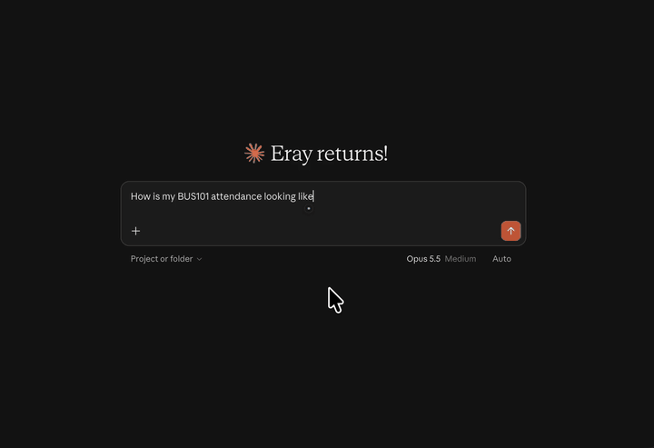

<p align="center">
  
</p>

<h1 align="center">🏴‍☠️ Mcp4Lms</h1>

Connect Claude (or any MCP client) to your university's LMS. Works with Moodle™.

Students connect once with a bookmark, get a personal key, and add one URL to Claude.
Claude then gets **read-only** access to their courses, contents, deadlines, assignments,
grades, announcements and the text of course files.

<p align="center">
  
</p>

One deployment serves one LMS. Mcp4Lms is not affiliated with or endorsed by any university,
Moodle HQ, Anthropic, OpenAI, Google or Anysphere.

> 🤝 **Contributions are welcome.** This project handles students' LMS access, so security
> reviews and hardening are the most valuable help: read [`src/crypto.ts`](src/crypto.ts),
> [`src/app.ts`](src/app.ts) and [`src/web/bookmarklet.ts`](src/web/bookmarklet.ts) and open an
> issue or pull request for anything that looks wrong. Also welcome: bug reports, adding your
> university to [`src/universities.ts`](src/universities.ts), and testing against other
> Moodle™ sites and MCP clients.

## How login works

```
 Student's browser (on the LMS, logged in)            Mcp4Lms Worker
 ─────────────────────────────────────────            ──────────────
 1. Bookmarklet fetches
    /admin/tool/mobile/launch.php?…&confirmed=1
    → page with moodlemobile://token=…
 2. Encrypts {siteId, token, passport, ts}
    with the server's RSA-OAEP public key
 3. Opens /connect/finish#c=<ciphertext>  ───────────► 4. POST /api/connect
    (fragment: never sent to a server)                    decrypt, check age + one-time nonce,
                                                          verify token (get_site_info) and
                                                          siteId = md5(wwwroot + passport)
                                                       5. Create account, generate user key
 6. Student saves key  m4l_<id>_<secret>  ◄──────────     m4l_<id>_<secret> (shown once)

 Claude ── OAuth 2.1 (DCR + PKCE) ──► /authorize: student pastes key
                                      → LMS token decrypted, put in the grant's props
                                        (encrypted by the OAuth library with a key
                                        derived from the issued tokens)
 Claude ── Bearer token ────────────► /mcp: props decrypted in memory, stateless MCP
                                      server calls an allowlist of read-only functions
```

**What is stored**

| Where | What |
|---|---|
| D1 `accounts` | account id, LMS URL + user id, key verifier (HKDF), LMS token encrypted with AES-256-GCM under a key derived from the user's secret, and the expiry the user chose (24 hours, 7, 30 or 90 days; default 90) |
| KV `OAUTH_KV` | OAuth clients, grants and token hashes (`@cloudflare/workers-oauth-provider`); grant props are encrypted with token-derived keys |
| D1 `download_links` | per download link: account id, expiry, and the file URL + LMS token encrypted with AES-256-GCM under a key derived from a secret that only the link holds. Deleted after 15 minutes, and on reconnect, grant revoke or account deletion. The file itself is never stored; it is streamed from the LMS when the link is opened |
| Nowhere | the user key, the LMS password, plaintext LMS tokens, names, emails, course data |

Losing the key is harmless: connecting again issues a new key, invalidates the old one and
revokes all OAuth grants.

**Expiry.** When connecting, the student picks how long the stored token stays usable (24 hours,
7, 30 or 90 days; default 90) and can change it later on the Account page. After the chosen
moment, `/authorize`, `/account` and `/mcp` refuse the account (the MCP endpoint answers with a
"reconnect" error without calling the LMS), and the hourly cron revokes its grants, which deletes
the per-grant encrypted copies of the token, and deletes the row. Connecting again resets the expiry.

## Project layout

- `src/web/layout.ts` — light-only design system (CSS tokens, nav, footer, security headers). The ☠ glyph is
  the project's mark; `public/flag.png` is the logo, served as a static asset;
  the favicons and the MCP server icon (`favicon.ico`, `icon-*.png`, `apple-touch-icon.png`) are cut from it.
- `src/web/pages.ts` — all pages (home, connect, finish, consent, account, privacy).
- `src/web/bookmarklet.ts` — the connect script that runs on the LMS page.
- `src/web/i18n.ts` — all user-visible copy of the web pages, in English and Turkish.
- `diagrams/*.mmd` — Mermaid sources of the Privacy page diagrams (one per language). `npm run diagrams`
  renders them to `public/diagrams/*.svg`, which the page embeds as images (the CSP allows no inline scripts).

## Languages

The web pages are available in English (default) and Turkish. The language is resolved per request
in `src/app.ts`: `?lang=tr` or `?lang=en` wins and is remembered in a `lang` cookie (one year); otherwise
the cookie, then the browser's `Accept-Language`, then English. The EN / TR toggle in the nav keeps the
current path and query string (so it is safe on `/authorize`) and only replaces `lang`.

All copy lives in `src/web/i18n.ts`: `en` defines the shape (`Strings`), `tr` must provide every key, and
the page renderers read `strings[lang]`. Strings that reach inline scripts or the bookmarklet are plain
strings with `{placeholders}`. The bookmark name `☠ Connect Mcp4Lms`, code snippets, vendor UI paths
("Settings → Connectors") and the MCP tool descriptions in `src/mcp.ts` (read by the AI) stay in English.

To add a language: add its code to `Lang` and `LANGS` in `i18n.ts`, add a full `Strings` object to
`strings`, and optionally translate university names via `names` in `src/universities.ts`. The toggle
and the `Accept-Language` matching pick it up automatically.

## Development

```bash
npm install
npm run keys                 # writes CONNECT_PRIVATE_KEY to .dev.vars
npm run db:migrate:local
npm run dev                  # http://localhost:8787
```

To try the real flow locally, open http://localhost:8787/connect, drag the **☠ Connect Mcp4Lms**
bookmark to your bookmarks bar, open the LMS and click it. Then add `http://localhost:8787/mcp` to an MCP
client (for example `npx @modelcontextprotocol/inspector`).

## Deploying your own instance

1. Edit `vars` in `wrangler.jsonc` (`PUBLIC_URL`, `LMS_URL`, `REPO_URL`).
2. Create storage and put the ids in `wrangler.jsonc`:
   ```bash
   npx wrangler kv namespace create OAUTH_KV
   npx wrangler d1 create mcp4lms
   npm run db:migrate:remote
   ```
   The `ratelimits` `namespace_id`s in `wrangler.jsonc` only need to be unique within your
   Cloudflare account; change them if they clash with another Worker's.
3. Set the connect key (rotating it invalidates bookmarks people already saved):
   ```bash
   npm run -s keys -- --print | npx wrangler secret put CONNECT_PRIVATE_KEY
   ```
4. `npm run deploy`

The LMS must have the Moodle mobile web service enabled (it is whenever the official
Moodle app works).

## Limits and known gaps

- Desktop only for connecting (bookmarklets and DevTools aren't practical on phones).
  After connecting, Claude works anywhere.
- Rate limits are per IP (Workers Rate Limiting, see `src/ratelimit.ts`) on `/api/connect`,
  `/register`, `/token`, the key forms (`POST /authorize`, `/account`) and `/dl`. They are
  approximate (counted per Cloudflare location) and kept generous, since a campus NAT or
  Claude's servers put many users behind one IP. `/mcp` is not limited by IP.
- `read_file` converts PDF, Word, PowerPoint, text and HTML files to text (30 MB limit). Images,
  scanned PDFs (no text layer) and other file types are attached as the original file (up to
  10 MB, images 5 MB); whether the client can read an attached PDF depends on the client. Links
  outside the LMS are fetched anonymously and only after the AI has asked the user and passes
  `confirmed_by_user`.
- `get_download_link` (and `read_file`, for files too large to attach) gives a download link valid
  for 15 minutes. Anyone holding the link can download that one file until it expires. The link
  contains a secret, so it shows up in request logs while valid (e.g. Workers observability); after
  expiry the row is deleted and the link decrypts nothing.
- While a request is being served, the server handles the LMS token in memory. Users have
  to trust that the deployment runs this code.
- Expiry (and deletion) does not revoke the app token on the LMS itself: that would need the
  plaintext token, which the server does not have at expiry time. Users can end it by logging
  out of all devices on the LMS.

## License and disclaimer

Mcp4Lms is free software under the [GNU AGPL-3.0-or-later](LICENSE). If you run a modified
version as a network service, the AGPL requires you to offer its source to your users.

It is provided as is, without warranty, and is not affiliated with any university, Moodle HQ,
Anthropic, OpenAI, Google or Anysphere. See the Privacy page of a running instance for the full disclaimer.
