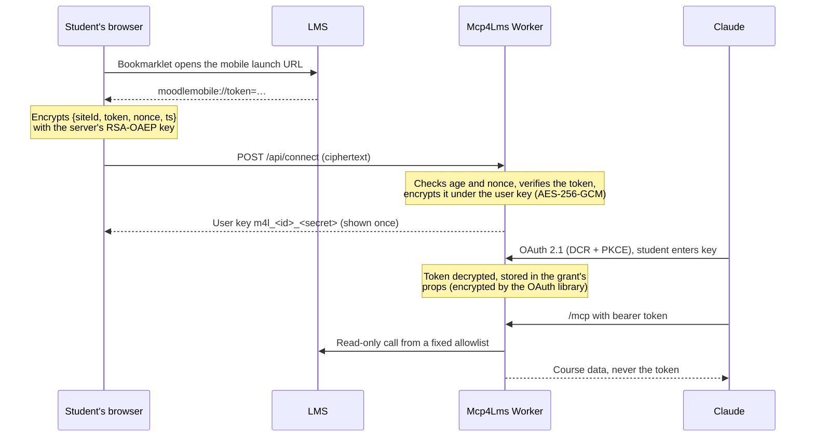

<p align="center">
  
</p>

<h1 align="center">🏴‍☠️ Mcp4Lms</h1>

<p align="center">Connect Claude (or any MCP client) to your university's LMS. Works with Moodle™.</p>

Students connect once with a bookmark, get a personal key, and add one URL to Claude. Claude then
gets **read-only** access to their courses, deadlines, assignments, grades, announcements and the
text of course files.

<p align="center">
  
</p>

> [!NOTE]
> Mcp4Lms is an experimental, non-profit, volunteer-run open-source project.
> It is not affiliated with or endorsed by any university, Moodle HQ, Anthropic, OpenAI,
> Google or Anysphere.

## 📑 Contents

- [🔐 How it works](#-how-it-works)
- [🏫 For universities and LMS admins](#-for-universities-and-lms-admins)
- [🏢 Hosted MCP for institutions](#-hosted-mcp-for-institutions)
- [🛡️ Security](#️-security)
- [🧑‍💻 Development](#-development)
- [🚀 Deploying your own instance](#-deploying-your-own-instance)
- [⚠️ Limits and known gaps](#️-limits-and-known-gaps)
- [📄 License](#-license)

## 🔐 How it works



**What is stored**

| Where | What |
|---|---|
| D1 `accounts` | Account id, LMS URL and user id, an HKDF key verifier, the LMS token encrypted with AES-256-GCM under a key derived from the user key, and the chosen expiry |
| KV `OAUTH_KV` | OAuth clients, grants and token hashes. Grant props are encrypted with token-derived keys |
| D1 `download_links` | Per link: the file URL and LMS token, encrypted under a secret only the link holds. Deleted on use, after 5 minutes, or on reconnect, revoke or deletion |
| Nowhere | The user key, the LMS password, plaintext tokens, names, emails, course data |

- **Expiry.** Students choose 24 hours, 7, 30 or 90 days (default 90). After that the account is
  refused, and an hourly cron revokes its grants and deletes the row.
- **Lost key.** Connecting again issues a new key, invalidates the old one and revokes all grants.
- **No access logs.** Workers invocation logs are off and the code writes no request logs.

## 🏫 For universities and LMS admins

Mcp4Lms uses the same app token as the official Moodle mobile app, only for read-only calls on
the student's own data. Today it works without the institution's involvement, which is not ideal
for anyone. We would much rather build an **official, consent-gated path** with you: a registered
client on your LMS, a standard OAuth flow instead of a bookmarklet, and scopes you define. That
gives your institution control over data and permissions, gives students an easier and safer
sign-in, and lets maintainers replace workarounds with proper verification and client registration.

We would prefer to work with your IT and legal teams. Write to
[maintainers@mcp4lms.com](mailto:maintainers@mcp4lms.com). The
[guideline for institutions](docs/INSTITUTIONS.md) ([Türkçe](docs/INSTITUTIONS.tr.md)) lists the steps for collaborations, self-hosting
and opt-outs.

**Requesting an opt-out**

- Write from an official institutional address and include your concerns and any policy or legal
  basis. A request does not by itself guarantee removal; every request is reviewed and answered.
- Please send requests as non-confidential. Approved takedowns affect many students, so they are
  shared publicly as proof to the community. Requests about a proven privacy issue, security flaw
  or incident, or a newly discovered security or design flaw are not published.
- Opted-out institutions are removed from the hosted version and added to a blocklist in this
  repository, so self-hosted copies do not work with them out of the box.

## 🏢 Hosted MCP for institutions

We encourage institutions to run their own MCP service, tailored to their policies and systems.
Fork this repository and deploy your own instance under the [license](#-license); volunteers may
help bring it in as an official, institution-governed resource. Self-hosting gives you control
over consent, access logging, AI policies, permissions, entity controls and RBAC. Collaboration
depends on volunteer availability and is not guaranteed. Mcp4Lms never asks for payment.

## 🛡️ Security

Report vulnerabilities privately to [security@mcp4lms.com](mailto:security@mcp4lms.com), not in a
public issue. Each instance also serves `/.well-known/security.txt`.

Security reviews are the most valuable contribution. Start with [`src/crypto.ts`](src/crypto.ts),
[`src/app.ts`](src/app.ts) and [`src/web/bookmarklet.ts`](src/web/bookmarklet.ts). Bug reports,
new universities in [`src/universities.ts`](src/universities.ts) and testing with other Moodle™
sites and MCP clients are also welcome.

## 🧑‍💻 Development

```bash
npm install
npm run keys                 # writes CONNECT_PRIVATE_KEY to .dev.vars
npm run db:migrate:local
npm run dev                  # http://localhost:8787
npm run typecheck            # the only automated check
npm run diagrams             # re-render diagrams/*.mmd to public/diagrams/*.svg
```

To try the real flow, open `http://localhost:8787/connect`, drag the **☠ Connect Mcp4Lms**
bookmark to your bookmarks bar and click it on the LMS. Then add `http://localhost:8787/mcp` to
an MCP client such as `npx @modelcontextprotocol/inspector`.

**Where things live**

- `src/app.ts` is the web app, `src/mcp.ts` the MCP server, `src/moodle.ts` the read-only Moodle client.
- `src/web/pages.ts` renders the pages and `src/web/layout.ts` holds the design system and security headers.
- `src/web/i18n.ts` holds all copy. `en` defines the shape and `tr` must provide every key.
  Language comes from `?lang=`, then a cookie, then `Accept-Language`.
- `diagrams/*.mmd` are the Privacy page diagrams, rendered to SVG because the CSP allows no inline Mermaid.

## 🚀 Deploying your own instance

1. Set `PUBLIC_URL`, `LMS_URL` and `REPO_URL` under `vars` in `wrangler.jsonc`.
2. Create storage and put the ids in `wrangler.jsonc`. The `ratelimits` namespace ids only need to
   be unique within your Cloudflare account.
   ```bash
   npx wrangler kv namespace create OAUTH_KV
   npx wrangler d1 create mcp4lms
   npm run db:migrate:remote
   ```
3. Set the connect key. Rotating it invalidates bookmarks people already saved.
   ```bash
   npm run -s keys -- --print | npx wrangler secret put CONNECT_PRIVATE_KEY
   ```
4. Run `npm run deploy`.

The LMS needs the Moodle mobile web service enabled, which it is whenever the official Moodle app works.

## ⚠️ Limits and known gaps

- Connecting needs a computer. After that, Claude works anywhere.
- Rate limits are per IP and approximate, kept generous for campus NATs. `/mcp` is not IP-limited.
- `read_file` converts PDF, Word, PowerPoint, text and HTML to text (30 MB). Other files are
  attached as-is (10 MB, images 5 MB). Links outside the LMS are fetched anonymously, only after
  the user confirms.
- Download links work once, within 5 minutes. A `HEAD` request does not use them up.
- The server handles the token in memory while serving a request, so users must trust that the
  deployment runs this code.
- Expiry and deletion do not revoke the token on the LMS itself. Students can end it by logging
  out of all devices there.

## 📄 License

Free software under the [GNU AGPL-3.0-or-later](LICENSE). If you run a modified version as a
network service, you must offer its source to your users. Provided as is, without warranty. See
the Privacy page of a running instance for the full disclaimer.
